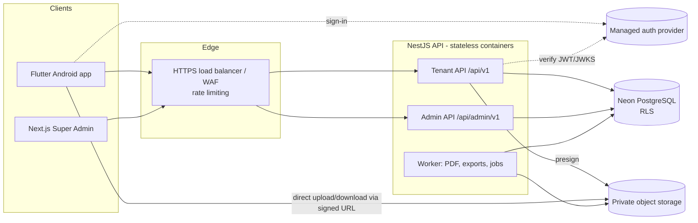

# Invoiceflow — Technical Architecture and Backend API

| | |
|---|---|
| **Document** | Master Document 3 of 4 |
| **Version** | 1.0 |
| **Related** | [PRD.md](PRD.md) · [DATABASE_ERD.md](DATABASE_ERD.md) · [SPRINT_BACKLOG.md](SPRINT_BACKLOG.md) |

---

## 1. Technology stack

| Layer | Technology | Notes |
|---|---|---|
| Mobile (Android, later iOS) | Flutter / Dart | Riverpod state, `go_router`, `dio`, `drift` for local drafts |
| Backend | NestJS on Node.js LTS, TypeScript (strict) | Modular monolith |
| Database | Neon PostgreSQL 16+ | Pooled endpoint for API; direct endpoint for migrations |
| ORM / migrations | **Drizzle** (recommended, D-01) | SQL migrations committed to repo |
| Super Admin | Next.js (App Router) / React | Separate deploy, separate auth realm |
| Authentication | Managed provider behind `AuthProvider` interface (D-02) | Backend verifies provider JWT, issues nothing it doesn't need |
| File storage | S3-compatible private bucket (D-03) | Pre-signed URLs, 5-minute expiry |
| PDF | Server-side HTML → PDF (Playwright/Chromium) worker | Templates versioned in repo |
| Excel export | `exceljs` | Streamed |
| Jobs / queue | `pg-boss` (Postgres-backed) | Avoids extra infra for MVP |
| API | REST/JSON, OpenAPI 3.1 via `@nestjs/swagger` | Generated Dart client for Flutter |
| Validation | `class-validator` / Zod at DTO boundary | |
| Testing | Jest (unit), Supertest + Testcontainers Postgres (integration), Flutter widget/integration tests | |
| CI/CD | GitHub Actions | |
| Monitoring | Sentry (errors), OpenTelemetry → provider of choice (traces/metrics), structured JSON logs | |

All versions pinned (lockfiles committed). Upgrades go through a dependency-review PR.

---

## 2. System architecture



**Principles**
- All financial and tenant logic runs in the backend. The mobile app has no DB credentials and never computes authoritative totals.
- Modular monolith: one deployable, strict module boundaries; modules talk through service interfaces, not each other's repositories.
- Stateless API containers; horizontal scaling.
- Tenant API and Admin API are separate route trees with separate guards, DB roles and auth audiences.

---

## 3. Backend module structure

```
apps/api/src/
  main.ts
  app.module.ts
  common/            # filters, interceptors, pipes, pagination, money, errors
  infrastructure/    # db (drizzle, tx manager), storage, pdf, queue, auth-provider
  modules/
    auth/  tenants/  users/  permissions/  subscriptions/
    customers/  suppliers/  items/
    quotations/  invoices/  credit-notes/  receipts/
    purchases/  supplier-payments/  expenses/
    banking/  tax/  reports/  documents/  audit/
    posting/         # shared posting service: numbering, tax lines, bank txns, domain events
    admin/           # Super Admin endpoints
```

Each module: `*.controller.ts`, `*.service.ts`, `*.repository.ts`, `dto/`, `*.spec.ts`, `*.int-spec.ts`.

### 3.1 Request pipeline (tenant API)

1. **AuthGuard** — verifies bearer JWT against provider JWKS; resolves `users.id` from `auth_provider_id`.
2. **TenantGuard** — reads `X-Tenant-Id` header; loads active membership for (user, tenant). No membership → `403 TENANT_ACCESS_DENIED`. The header is a *selector*; authority comes from the membership row.
3. **SubscriptionGuard** — on write routes, rejects if subscription `suspended`/`cancelled` (`402 SUBSCRIPTION_INACTIVE`) or plan limit exceeded (`402 PLAN_LIMIT_REACHED`).
4. **PermissionGuard** — `@RequirePermission('invoice.issue')` checked against role permissions.
5. **TransactionInterceptor** — opens a DB transaction, runs `set_config('app.tenant_id', …, true)` and `app.user_id`, commits/rolls back.
6. **IdempotencyInterceptor** — on POST routes marked `@Idempotent()`, requires `Idempotency-Key` header; replays stored response on retry, `409` on same key with different body.
7. **AuditInterceptor** — writes `audit_logs` row in the same transaction for mutating routes.

### 3.2 Posting service

Single entry point for every financial posting (`issueInvoice`, `postReceipt`, `postBill`, `postExpense`, `postTransfer`, `void*`). Inside one transaction it:

1. Locks the document (`SELECT … FOR UPDATE`) and checks the state transition.
2. Recalculates all amounts server-side (see §5).
3. Allocates the document number from `document_sequences`.
4. Writes snapshots, `tax_transaction_lines`, `bank_transactions`, allocation counters.
5. Emits a domain event (in-process) — V2 journal writer hooks in here.
6. Writes the audit log.
7. Commits atomically; any failure rolls back everything, including the number.

---

## 4. Environments

| | Development | Staging | Production |
|---|---|---|---|
| API | `api-dev.<domain>` | `api-staging.<domain>` | `api.<domain>` |
| Database | Neon project `invoiceflow-dev` (branch per PR) | `invoiceflow-staging` | `invoiceflow-prod`, PITR 7–30 days |
| Storage | `invoiceflow-dev` bucket | `invoiceflow-staging` | `invoiceflow-prod` (versioning on) |
| Auth | Dev project | Staging project | Prod project |
| Data | Synthetic seed | Sanitised/synthetic | Live |
| Deploy | Every merge to `develop` | Release branch / tag `rc-*` | Manual approval on tag `v*` |

Secrets live in the platform secret manager / GitHub environment secrets, never in the repo. Production customer data is never copied to lower environments unless anonymised and authorised.

### 4.1 Branch and release strategy

- `main` = production; `develop` = integration; `feature/<ticket>-<slug>`; `release/x.y`; `hotfix/<slug>`.
- PRs require: green CI, 1 approval; **2 approvals + label `needs-human-review`** for migrations, money/tax logic, auth, RLS or permissions.
- CI: lint → typecheck → unit → integration (Testcontainers + RLS tests) → OpenAPI diff → build → Flutter analyze/test → APK build.

---

## 5. Financial calculation rules (summary — full detail in `ACCOUNTING_RULES.md`)

Per line:
```
gross        = round2(quantity × unit_price)
net          = gross − line_discount
tax_amount   = round2(net × tax_rate / 100)        -- rate looked up by document date
line_total   = net + tax_amount
```
Per document:
```
subtotal        = Σ gross
discount_amount = Σ line_discount (+ document discount pro-rated to lines before tax)
tax_amount      = Σ line tax_amount
total_amount    = subtotal − discount_amount + tax_amount
```
- Rounding: half-up to 2 dp at line level (D-11, pending adviser confirmation). Stored at 4 dp.
- Arithmetic uses a decimal library (`decimal.js`) — never JS `number` for money.
- VAT-inclusive entry: `net = round2(inclusive / (1 + rate/100))`, `tax = inclusive − net`.
- Non-VAT-registered tenant: sales lines forced to `OS` with 0 tax.
- Financial test pack (PRD/TEST_PLAN) runs in CI on every PR.

---

## 6. Security

### 6.1 Controls

| Area | Control |
|---|---|
| Transport | TLS 1.2+; HSTS on web |
| AuthN | Provider-issued JWT (≤ 1 h), refresh handled by provider SDK; backend checks `aud`, `iss`, `exp`, email verified for posting routes |
| AuthZ | Membership + permission codes; never role names |
| Tenant isolation | Backend guard **and** forced RLS; composite FKs; mandatory cross-tenant tests |
| Admin access | Separate auth audience + MFA required; `invoiceflow_admin` DB role; every tenant-data read audited with reason |
| Input | DTO validation, whitelist, size limits; reject unknown fields |
| Files | Type/size checked at presign and confirm (magic-byte sniff); private bucket; 5-min signed URLs; key prefix `tenants/{tenant_id}/` |
| Rate limits | Auth endpoints 10/min/IP; general 300/min/user |
| Secrets | Secret manager; rotated; never logged |
| Logging | No passwords, tokens, full account numbers; PII minimised |
| Mobile | No secrets in APK; certificate pinning (P1); secure storage for tokens; screenshots allowed |
| Dependencies | Dependabot + `npm audit` / `osv-scanner` in CI |

### 6.2 Permission catalogue (seed)

```
tenant.view  tenant.update  tenant.settings.update
user.view  user.invite  user.update  role.view  role.manage
subscription.view  subscription.manage
customer.view  customer.create  customer.update
supplier.view  supplier.create  supplier.update
item.view  item.create  item.update
quotation.view  quotation.create  quotation.update  quotation.send  quotation.convert
invoice.view  invoice.create  invoice.update  invoice.issue  invoice.cancel
credit_note.create  credit_note.issue  credit_note.void
receipt.view  receipt.create  receipt.allocate  receipt.void
purchase.view  purchase.create  purchase.post  purchase.void
supplier_payment.view  supplier_payment.create  supplier_payment.void
expense.view  expense.create  expense.post  expense.void
bank.view  bank.manage  bank.transaction.create  bank.transfer.create
tax.view  tax.settings.update
report.sales  report.purchases  report.banking  report.tax  report.profit_loss  report.export
document.upload  document.view  document.delete
audit.view
```

Default mapping: Owner = all; Administrator = all except `subscription.manage`; Accountant = all financial + reports, no user/role management; Sales User = customer.\*, item.view, quotation.\*, invoice.view/create/update/issue, receipt.view, report.sales; Purchase User = supplier.\*, item.view, purchase.\*, expense.\*, supplier_payment.view, document.upload/view, report.purchases; Cashier = customer.view, supplier.view, receipt.\*, supplier_payment.\*, bank.view, bank.transaction.create, report.banking.

---

## 7. API standards

- **Base URLs:** tenant `/api/v1`, admin `/api/admin/v1`.
- **Auth:** `Authorization: Bearer <jwt>`.
- **Tenant selection:** `X-Tenant-Id: <uuid>` on all tenant-scoped routes (validated against membership).
- **Idempotency:** `Idempotency-Key: <uuid>` required on all posting POSTs (marked 🔒 below).
- **Concurrency:** drafts return `version`; `PATCH` must send `If-Match: <version>`; mismatch → `409 VERSION_CONFLICT`.
- **Money in JSON:** decimal **strings** (`"1050.00"`), never floats. Dates `YYYY-MM-DD`; timestamps ISO-8601 UTC.
- **Pagination:** `?page=1&pageSize=25` (max 100). Response `meta: { page, pageSize, total, totalPages }`.
- **Filtering/sorting:** `?search=`, `?status=issued,paid`, `?from=2026-01-01&to=2026-01-31`, `?sort=-invoiceDate,invoiceNumber`.
- **Casing:** JSON `camelCase`; DB `snake_case`.

### 7.1 Envelopes

```json
{ "success": true, "data": { }, "meta": { }, "message": "Request completed" }
```
```json
{
  "success": false,
  "error": {
    "code": "VALIDATION_ERROR",
    "message": "Please check the submitted information",
    "details": [ { "field": "lines[0].quantity", "message": "Quantity must be greater than 0" } ],
    "requestId": "req_01J..."
  }
}
```

### 7.2 Error codes

| HTTP | Code | When |
|---|---|---|
| 400 | `VALIDATION_ERROR` | DTO / business validation failed |
| 401 | `UNAUTHENTICATED` | Missing/invalid token |
| 403 | `TENANT_ACCESS_DENIED` | No active membership |
| 403 | `PERMISSION_DENIED` | Missing permission code |
| 403 | `EMAIL_NOT_VERIFIED` | Posting before email verification |
| 402 | `SUBSCRIPTION_INACTIVE` | Suspended/cancelled tenant attempting a write |
| 402 | `PLAN_LIMIT_REACHED` | Plan feature limit hit |
| 404 | `NOT_FOUND` | Missing **or other tenant's** resource (never reveal existence) |
| 409 | `VERSION_CONFLICT` | Stale `If-Match` |
| 409 | `INVALID_STATE_TRANSITION` | e.g. issuing a cancelled invoice |
| 409 | `DUPLICATE` | Unique code/number clash, duplicate conversion |
| 409 | `IDEMPOTENCY_CONFLICT` | Key reused with different payload |
| 422 | `ALLOCATION_EXCEEDS_BALANCE` | Allocation > receipt unallocated or invoice balance |
| 422 | `CREDIT_EXCEEDS_INVOICE` | Credit note > creditable amount |
| 429 | `RATE_LIMITED` | |
| 500 | `INTERNAL_ERROR` | Unexpected; includes `requestId` |

---

## 8. Endpoint catalogue

🔒 = requires `Idempotency-Key`. Permission shown in brackets.

### 8.1 Auth & profile
| Method | Path | Notes |
|---|---|---|
| POST | `/auth/register` | Creates user record after provider sign-up (or server-side via provider admin SDK); returns user |
| POST | `/auth/login` | Only if provider requires server mediation; otherwise SDK login + `GET /auth/me` |
| POST | `/auth/logout` | Revokes refresh tokens at provider |
| POST | `/auth/forgot-password` | Always 200 (no account enumeration) |
| POST | `/auth/reset-password` | |
| POST | `/auth/verify-email/resend` | |
| GET | `/auth/me` | User + memberships (tenant id, name, role, permissions) |

### 8.2 Tenants & settings
| Method | Path | Permission |
|---|---|---|
| POST | `/tenants` | authenticated — creates tenant, owner membership, defaults (TEN-010) |
| GET | `/tenants` | own memberships |
| GET | `/tenants/:id` | `tenant.view` |
| PATCH | `/tenants/:id` | `tenant.update` |
| POST | `/tenants/:id/complete-onboarding` | `tenant.update` |
| GET / PATCH | `/tenants/:id/settings` | `tenant.view` / `tenant.settings.update` |
| GET / PATCH | `/tenants/:id/numbering` | `tenant.settings.update` |
| PUT | `/tenants/:id/logo` | body `{ documentId }` |

### 8.3 Users, roles, permissions
| Method | Path | Permission |
|---|---|---|
| GET | `/users` | `user.view` |
| POST | `/users/invite` | `user.invite` (plan `max_users` checked) |
| POST | `/invitations/:token/accept` | authenticated |
| PATCH | `/users/:id` | `user.update` (role, status) |
| GET / POST | `/roles` | `role.view` / `role.manage` |
| PATCH / DELETE | `/roles/:id` | `role.manage` (system roles immutable; in-use roles cannot be deleted) |
| GET | `/permissions` | `role.view` |

### 8.4 Master data
| Method | Path | Permission |
|---|---|---|
| GET / POST | `/customers` | `customer.view` / `customer.create` |
| GET / PATCH | `/customers/:id` | `customer.view` / `customer.update` |
| POST | `/customers/:id/opening-balance` 🔒 | `customer.update` |
| GET | `/customers/:id/transactions` | `customer.view` |
| GET | `/customers/:id/statement?from&to&format=json\|pdf` | `customer.view` |
| GET | `/customers/duplicates?name&email&trn` | `customer.create` |
| — | `/suppliers…` | identical set with `supplier.*` |
| GET / POST | `/items` | `item.view` / `item.create` |
| GET / PATCH | `/items/:id` | `item.view` / `item.update` |
| GET / POST / PATCH | `/expense-categories` | `expense.view` / `tenant.settings.update` |

### 8.5 Quotations
| Method | Path | Permission |
|---|---|---|
| GET / POST | `/quotations` | `quotation.view` / `quotation.create` |
| GET / PATCH | `/quotations/:id` | `quotation.view` / `quotation.update` (draft only) |
| POST | `/quotations/:id/send` | `quotation.send` — assigns number |
| POST | `/quotations/:id/accept` · `/reject` | `quotation.update` |
| POST | `/quotations/:id/convert` 🔒 | `quotation.convert` — returns draft invoice; 409 `DUPLICATE` if already converted |
| GET | `/quotations/:id/pdf` | `quotation.view` |
| POST | `/quotations/calculate` | `quotation.create` — preview totals, no persistence |

### 8.6 Invoices & credit notes
| Method | Path | Permission |
|---|---|---|
| GET / POST | `/invoices` | `invoice.view` / `invoice.create` (creates draft) |
| GET / PATCH | `/invoices/:id` | `invoice.view` / `invoice.update` (draft only) |
| DELETE | `/invoices/:id` | `invoice.update` (draft only) |
| POST | `/invoices/calculate` | preview totals |
| POST | `/invoices/:id/issue` 🔒 | `invoice.issue` |
| POST | `/invoices/:id/cancel` 🔒 | `invoice.cancel` — body `{ reason }` |
| GET | `/invoices/:id/pdf` | `invoice.view` — returns signed URL |
| POST | `/invoices/:id/credit-notes` | `credit_note.create` (draft) |
| GET / PATCH | `/credit-notes/:id` | `invoice.view` / `credit_note.create` |
| POST | `/credit-notes/:id/issue` 🔒 · `/void` 🔒 | `credit_note.issue` / `credit_note.void` |
| GET | `/credit-notes/:id/pdf` | `invoice.view` |

**`POST /invoices/:id/issue` – sequence**
1. Tenant + permission + subscription guards. 2. Lock invoice; require `status = draft`, matching `If-Match`. 3. Validate customer active, ≥1 line, quantities > 0. 4. Recalculate lines and totals server-side using rates effective on `invoiceDate`. 5. Validate tax codes allowed for tenant VAT status. 6. Allocate number. 7. Write snapshots, set `issued`, `issued_at`. 8. Write `tax_transaction_lines`. 9. Audit `invoice.issued` + domain event. 10. Commit. Response: full invoice.

### 8.7 Receipts
| Method | Path | Permission |
|---|---|---|
| GET | `/receipts` | `receipt.view` |
| POST | `/receipts` 🔒 | `receipt.create` — body may include `allocations[]` |
| GET | `/receipts/:id` | `receipt.view` |
| POST | `/receipts/:id/allocate` 🔒 | `receipt.allocate` — allocate unallocated balance |
| POST | `/receipts/:id/void` 🔒 | `receipt.void` — `{ reason }` |
| GET | `/receipts/:id/pdf` | `receipt.view` |

**`POST /receipts` – request**
```json
{
  "customerId": "…", "receiptDate": "2026-11-06", "paymentMethod": "bank_transfer",
  "bankAccountId": "…", "amount": "600.00", "reference": "TT-8812",
  "allocations": [ { "invoiceId": "…", "amount": "600.00" } ]
}
```
Sequence: validate customer and account → lock target invoices `FOR UPDATE` (ordered by id to avoid deadlocks) → check each allocation ≤ invoice balance and Σ ≤ amount → insert receipt with number → insert allocations → update invoice `amount_paid` + status → insert `bank_transactions` (+1) → audit → commit.

### 8.8 Purchases, supplier payments, expenses
| Method | Path | Permission |
|---|---|---|
| GET / POST | `/purchases` | `purchase.view` / `purchase.create` (draft) |
| GET / PATCH / DELETE | `/purchases/:id` | draft edit/delete |
| POST | `/purchases/:id/post` 🔒 · `/void` 🔒 | `purchase.post` / `purchase.void` |
| GET / POST | `/supplier-payments` 🔒 | `supplier_payment.*` |
| GET | `/supplier-payments/:id` | |
| POST | `/supplier-payments/:id/allocate` 🔒 · `/void` 🔒 | |
| GET / POST | `/expenses` | `expense.view` / `expense.create` — `?post=true` creates and posts in one call 🔒 |
| GET / PATCH | `/expenses/:id` | draft only |
| POST | `/expenses/:id/post` 🔒 · `/void` 🔒 | `expense.post` / `expense.void` |

### 8.9 Banking
| Method | Path | Permission |
|---|---|---|
| GET / POST | `/bank-accounts` | `bank.view` / `bank.manage` (`accountType: bank\|cash`) |
| GET / PATCH | `/bank-accounts/:id` | includes computed `balance` |
| GET | `/bank-accounts/:id/transactions?from&to` | running balance |
| GET | `/bank-accounts/:id/statement?from&to&format=pdf\|xlsx` | `report.export` |
| GET | `/bank-transactions` | `bank.view` |
| POST | `/bank-transactions` 🔒 | `bank.transaction.create` — deposit/withdrawal only |
| POST | `/bank-transactions/:id/reverse` 🔒 | manual entries only |
| POST | `/bank-transfers` 🔒 | `bank.transfer.create` — creates transfer + 2 bank transactions |
| POST | `/bank-transfers/:id/void` 🔒 | |

### 8.10 Tax
| Method | Path | Permission |
|---|---|---|
| GET / PATCH | `/tax/settings` | `tax.view` / `tax.settings.update` |
| GET | `/tax/codes` | `tax.view` — global + tenant codes with current rate |
| POST | `/tax/codes` | `tax.settings.update` — tenant-specific code |
| GET | `/tax/periods` | list of configured VAT periods |
| GET | `/tax/summary?periodStart&periodEnd` | `report.tax` |
| GET | `/tax/transactions?from&to&taxCode&direction` | `report.tax` |

### 8.11 Reports
All accept `from`, `to`, `search`, `sort`, `page`, `pageSize`, `format=json|pdf|xlsx`. PDF/XLSX > 5,000 rows run async: response `202 { jobId }`, poll `GET /exports/:jobId`.

| Path | Permission |
|---|---|
| `/reports/dashboard?period=today\|week\|month\|quarter\|year\|custom` | any `*.view` |
| `/reports/sales` · `/reports/quotations` · `/reports/collections` · `/reports/receivables` | `report.sales` |
| `/reports/purchases` · `/reports/expenses` · `/reports/payables` | `report.purchases` |
| `/reports/bank` · `/reports/cash` | `report.banking` |
| `/reports/profit-loss` | `report.profit_loss` |
| `/reports/vat-summary` | `report.tax` |
| `/reports/customer-statement` · `/reports/supplier-statement` | `customer.view` / `supplier.view` |

**Dashboard response**
```json
{
  "period": { "from": "2026-11-01", "to": "2026-11-30" },
  "currency": "AED",
  "sales": "1000.00", "collections": "600.00", "receivablesOutstanding": "450.00",
  "purchases": "200.00", "expenses": "100.00", "payablesOutstanding": "210.00",
  "cashBalance": "…", "bankBalance": "…",
  "estimatedProfit": "700.00",
  "outputVat": "50.00", "inputVat": "10.00"
}
```

### 8.12 Documents
| Method | Path | Notes |
|---|---|---|
| POST | `/documents/upload-url` | `{ filename, mimeType, fileSize }` → `{ documentId, uploadUrl, headers, expiresAt }`; rejects bad type/size |
| POST | `/documents/confirm-upload` | `{ documentId, entityType, entityId }`; HEADs object, sniffs magic bytes, marks `available`, creates link |
| GET | `/documents/:id/download-url` | 5-min signed URL; checks tenant + entity permission |
| GET | `/documents?entityType&entityId` | list attachments |
| DELETE | `/documents/:id` | only if linked entity is still draft, or `document.delete` on posted (soft delete, audited) |

### 8.13 Subscription (tenant side)
| Method | Path | Permission |
|---|---|---|
| GET | `/subscription` | `subscription.view` — plan, status, limits, usage |
| GET | `/subscription/plans` | `subscription.view` |
| POST | `/subscription/change-request` | `subscription.manage` — notifies admin (manual MVP flow) |

### 8.14 Audit
| GET | `/audit-logs?entityType&entityId&userId&from&to` | `audit.view` |
|---|---|---|

### 8.15 Super Admin (`/api/admin/v1`)
| Method | Path | Notes |
|---|---|---|
| GET | `/dashboard` | tenants by status, MRR estimate, signups, active users |
| GET / POST | `/tenants` | list/search; create (assisted onboarding) |
| GET | `/tenants/:id` | requires `reason` query param → audited |
| PATCH | `/tenants/:id/status` | suspend/reactivate with reason |
| GET | `/subscriptions` | filter by status/plan/renewal |
| PATCH | `/subscriptions/:id` | change plan, extend trial, set period |
| POST | `/subscriptions/:id/payments` | record manual payment → activates |
| GET / POST / PATCH | `/plans`, `/plans/:id`, `/plans/:id/features` | |
| GET | `/platform-reports` | |
| GET | `/audit-logs` | platform + tenant events |
| GET / POST | `/admins` | manage Super Admin users (MFA enforced) |

---

## 9. PDF generation

- HTML templates (Handlebars) per document type and locale, rendered by a Chromium worker into PDF, stored in object storage under `tenants/{id}/pdf/{type}/{docId}-{version}.pdf`.
- Issued documents: PDF generated once on issue and cached; regenerated only if template version changes (same data).
- Tax invoice layout (VAT-registered): "Tax Invoice" title, seller TRN, customer TRN where applicable, per-line VAT rate and amount, totals in AED. **Layout to be verified against UAE requirements (TAX_RULES_UAE.md).**
- Share: app obtains signed URL and uses Android share sheet.

## 10. Observability and operations

- Every request has `requestId` (returned in `X-Request-Id`, included in errors and audit).
- Structured logs: `level, ts, requestId, tenantId, userId, route, status, durationMs`.
- Alerts: 5xx rate > 1%, p95 > 1 s, reconciliation-job mismatch (P1 alert), failed backups, queue backlog.
- Backups: Neon PITR + weekly logical dump to separate storage; restore drill each release (TEST_PLAN).
- Cost guardrails: Neon autosuspend in dev/staging, storage lifecycle rules, budget alerts.

## 11. Mobile app architecture (Flutter)

```
apps/mobile/lib/
  core/        # api client (generated), auth, tenant context, money formatting, errors, theme, l10n
  data/        # repositories, local draft store (drift)
  features/    # home, sales/{quotations,invoices,receipts,customers}, purchases/{bills,payments,expenses,suppliers},
               # banking, reports, settings, onboarding, subscription
  shared/      # widgets: amount field, date field, status badge, party picker, line editor
```
- State: Riverpod; navigation: `go_router` with bottom nav shell (Home, Sales, Purchases, Banking, More).
- Money: `decimal` package; display via `intl` with tenant currency.
- Drafts: autosaved locally every few seconds and synced as server drafts on save; recover prompt on reopen.
- Totals shown live using `/calculate` endpoints (debounced) — server remains authoritative.
- Strings externalised (ARB) from day one; RTL-safe layouts.
