# Invoiceflow — Database Architecture and ERD

| | |
|---|---|
| **Document** | Master Document 2 of 4 |
| **Version** | 1.0 |
| **Database** | Neon PostgreSQL (PostgreSQL 16+) |
| **Related** | [PRD.md](PRD.md) · [ARCHITECTURE_AND_API.md](ARCHITECTURE_AND_API.md) · [SPRINT_BACKLOG.md](SPRINT_BACKLOG.md) |

> All schema changes go through reviewed migrations. AI agents may draft migrations; a human must approve every migration before merge (PRD §8).

---

## 1. Database standards

| Rule | Standard |
|---|---|
| Primary keys | `uuid` (v7 generated in app for index locality; `gen_random_uuid()` fallback) |
| Tenant ownership | Every tenant-owned table has `tenant_id uuid NOT NULL` |
| Tenant-consistent FKs | Child → parent FKs are **composite** `(tenant_id, parent_id) → parent(tenant_id, id)`. Every tenant-owned parent has `UNIQUE (tenant_id, id)`. This makes cross-tenant references impossible at the DB level (integrity rule 11). |
| Money | `numeric(19,4)`; never `float`/`real`/`money` |
| Tax rates | `numeric(7,4)` (e.g. `5.0000` = 5%) |
| Quantities | `numeric(19,4)` |
| Currency | `char(3)` ISO 4217 |
| Timestamps | `timestamptz`, UTC; `created_at`, `updated_at` on all mutable tables |
| Business dates | `date` (interpreted in tenant timezone) |
| Status values | `text` + `CHECK` constraint (easier to evolve than PG enums) |
| Naming | `snake_case`, plural tables, `_id` FKs, `_at` timestamps, `_date` dates |
| Soft delete | Only master data (`status = 'inactive'`). Posted financial documents are never deleted; they are cancelled/voided. |
| Concurrency | `version integer` on documents for optimistic locking on draft edits |
| Audit | `audit_logs` is append-only (app DB role has `INSERT, SELECT` only) |

### 1.1 Database roles

| Role | Used by | Privileges |
|---|---|---|
| `invoiceflow_owner` | Migrations only (CI) | DDL |
| `invoiceflow_app` | NestJS tenant API | DML on tenant tables, **subject to RLS** (`NOBYPASSRLS`) |
| `invoiceflow_admin` | Super Admin API | Cross-tenant read via explicit admin policies; every query audited |
| `invoiceflow_report` | Reporting (optional read replica) | `SELECT`, subject to RLS |

---

## 2. Multi-tenancy and Row-Level Security

### 2.1 Tenant context

Tenant context is derived from the authenticated user's **membership**, never from a client-supplied value alone. The API sets it **transaction-locally** so pooled connections (Neon PgBouncer, transaction mode) never leak context:

```sql
BEGIN;
SELECT set_config('app.tenant_id', $1, true);   -- true = local to this transaction
SELECT set_config('app.user_id',   $2, true);
-- ... queries ...
COMMIT;
```

Every tenant-scoped request runs inside a transaction. Queries outside a transaction see no tenant rows (policy evaluates against NULL).

### 2.2 Standard policy (applied to every tenant-owned table)

```sql
ALTER TABLE customers ENABLE ROW LEVEL SECURITY;
ALTER TABLE customers FORCE ROW LEVEL SECURITY;

CREATE POLICY tenant_isolation ON customers
  USING      (tenant_id = current_setting('app.tenant_id', true)::uuid)
  WITH CHECK (tenant_id = current_setting('app.tenant_id', true)::uuid);
```

A migration test asserts that **every** table with a `tenant_id` column has RLS enabled, forced, and a `tenant_isolation` policy.

### 2.3 Tables with special policies

| Table | Policy |
|---|---|
| `tenants` | Visible where `id = app.tenant_id`, or to membership lookup via a `SECURITY DEFINER` function `my_tenants(user_id)` |
| `users` | Row visible to itself; tenant members visible via membership join |
| `tenant_memberships` | Rows for current tenant, plus own rows (for tenant switcher) |
| `roles` | `tenant_id IS NULL` (system templates, read-only) OR current tenant |
| `tax_codes`, `tax_rates` | `tenant_id IS NULL` (global) OR current tenant |
| `permissions`, `subscription_plans`, `plan_features`, `countries`, `currencies` | Global reference data, read-only to app role, no RLS |
| `audit_logs` | Insert any; select current tenant only (platform events `tenant_id IS NULL` visible to admin role only) |

---

## 3. Entity Relationship Diagram

```mermaid
erDiagram
    TENANTS ||--o{ TENANT_MEMBERSHIPS : has
    USERS ||--o{ TENANT_MEMBERSHIPS : joins
    ROLES ||--o{ TENANT_MEMBERSHIPS : assigned
    ROLES ||--o{ ROLE_PERMISSIONS : grants
    PERMISSIONS ||--o{ ROLE_PERMISSIONS : defines
    TENANTS ||--o{ TENANT_SETTINGS : configures
    TENANTS ||--|| TENANT_TAX_SETTINGS : has
    TENANTS ||--o{ DOCUMENT_SEQUENCES : numbers

    TENANTS ||--o{ CUSTOMERS : owns
    TENANTS ||--o{ SUPPLIERS : owns
    TENANTS ||--o{ ITEMS : owns
    TAX_CODES ||--o{ TAX_RATES : "effective-dated"
    TAX_CODES ||--o{ ITEMS : default_for

    CUSTOMERS ||--o{ QUOTATIONS : receives
    QUOTATIONS ||--|{ QUOTATION_ITEMS : contains
    QUOTATIONS |o--o| INVOICES : converts_to

    CUSTOMERS ||--o{ INVOICES : billed
    INVOICES ||--|{ INVOICE_ITEMS : contains
    INVOICES ||--o{ CREDIT_NOTES : adjusted_by
    CREDIT_NOTES ||--|{ CREDIT_NOTE_ITEMS : contains

    CUSTOMERS ||--o{ RECEIPTS : pays
    RECEIPTS ||--o{ RECEIPT_ALLOCATIONS : allocated
    INVOICES ||--o{ RECEIPT_ALLOCATIONS : settled_by

    SUPPLIERS ||--o{ PURCHASE_BILLS : issues
    PURCHASE_BILLS ||--|{ PURCHASE_ITEMS : contains
    SUPPLIERS ||--o{ SUPPLIER_PAYMENTS : paid
    SUPPLIER_PAYMENTS ||--o{ SUPPLIER_PAYMENT_ALLOCATIONS : allocated
    PURCHASE_BILLS ||--o{ SUPPLIER_PAYMENT_ALLOCATIONS : settled_by

    EXPENSE_CATEGORIES ||--o{ EXPENSES : classifies
    EXPENSE_CATEGORIES ||--o{ PURCHASE_ITEMS : classifies

    TENANTS ||--o{ BANK_ACCOUNTS : owns
    BANK_ACCOUNTS ||--o{ BANK_TRANSACTIONS : contains
    BANK_ACCOUNTS ||--o{ ACCOUNT_TRANSFERS : "source/destination"
    RECEIPTS ||--o| BANK_TRANSACTIONS : posts
    SUPPLIER_PAYMENTS ||--o| BANK_TRANSACTIONS : posts
    EXPENSES ||--o| BANK_TRANSACTIONS : posts

    TAX_CODES ||--o{ TAX_TRANSACTION_LINES : classifies

    SUBSCRIPTION_PLANS ||--o{ PLAN_FEATURES : includes
    SUBSCRIPTION_PLANS ||--o{ SUBSCRIPTIONS : defines
    TENANTS ||--o{ SUBSCRIPTIONS : subscribes
    SUBSCRIPTIONS ||--o{ SUBSCRIPTION_PAYMENTS : billed

    TENANTS ||--o{ DOCUMENTS : stores
    DOCUMENTS ||--o{ DOCUMENT_LINKS : attaches
    TENANTS ||--o{ AUDIT_LOGS : records
```



**Polymorphic links.** `bank_transactions.source_type/source_id`, `tax_transaction_lines.source_type/source_id` and `document_links.entity_type/entity_id` are polymorphic. They cannot use FKs, so integrity is enforced by (a) the posting service being the only writer and (b) a nightly reconciliation job (§7).

---

## 4. Reference DDL

The DDL below is the approved logical schema. The ORM migration must produce an equivalent physical schema. RLS statements (§2.2) are omitted per table for brevity but are mandatory.

### 4.1 Platform and access

```sql
CREATE TABLE tenants (
  id                    uuid PRIMARY KEY,
  legal_name            text NOT NULL,
  trading_name          text,
  country_code          char(2) NOT NULL DEFAULT 'AE',
  base_currency         char(3) NOT NULL DEFAULT 'AED',
  timezone              text NOT NULL DEFAULT 'Asia/Dubai',
  financial_year_start  smallint NOT NULL DEFAULT 1 CHECK (financial_year_start BETWEEN 1 AND 12),
  address               jsonb NOT NULL DEFAULT '{}',   -- {line1,line2,city,emirate,po_box}
  phone                 text,
  email                 text,
  logo_document_id      uuid,
  onboarding_completed_at timestamptz,
  status                text NOT NULL DEFAULT 'active' CHECK (status IN ('active','suspended','closed')),
  created_at            timestamptz NOT NULL DEFAULT now(),
  updated_at            timestamptz NOT NULL DEFAULT now()
);

CREATE TABLE users (
  id                uuid PRIMARY KEY,
  auth_provider     text NOT NULL,              -- e.g. 'firebase'
  auth_provider_id  text NOT NULL,
  full_name         text NOT NULL,
  email             citext NOT NULL UNIQUE,
  email_verified_at timestamptz,
  phone             text,
  status            text NOT NULL DEFAULT 'active' CHECK (status IN ('active','disabled')),
  created_at        timestamptz NOT NULL DEFAULT now(),
  updated_at        timestamptz NOT NULL DEFAULT now(),
  UNIQUE (auth_provider, auth_provider_id)
);

CREATE TABLE permissions (
  id              uuid PRIMARY KEY,
  permission_code text NOT NULL UNIQUE,         -- e.g. 'invoice.issue'
  module          text NOT NULL,
  description     text NOT NULL
);

CREATE TABLE roles (
  id          uuid PRIMARY KEY,
  tenant_id   uuid REFERENCES tenants(id),      -- NULL = system template
  name        text NOT NULL,
  is_system   boolean NOT NULL DEFAULT false,
  created_at  timestamptz NOT NULL DEFAULT now(),
  UNIQUE NULLS NOT DISTINCT (tenant_id, name)
);

CREATE TABLE role_permissions (
  role_id       uuid NOT NULL REFERENCES roles(id) ON DELETE CASCADE,
  permission_id uuid NOT NULL REFERENCES permissions(id),
  PRIMARY KEY (role_id, permission_id)
);

CREATE TABLE tenant_memberships (
  id          uuid PRIMARY KEY,
  tenant_id   uuid NOT NULL REFERENCES tenants(id),
  user_id     uuid NOT NULL REFERENCES users(id),
  role_id     uuid NOT NULL REFERENCES roles(id),
  is_owner    boolean NOT NULL DEFAULT false,
  status      text NOT NULL DEFAULT 'active' CHECK (status IN ('invited','active','disabled')),
  invited_by  uuid REFERENCES users(id),
  created_at  timestamptz NOT NULL DEFAULT now(),
  UNIQUE (tenant_id, user_id)
);
-- Trigger: a tenant must always retain ≥1 active owner.

CREATE TABLE user_invitations (
  id          uuid PRIMARY KEY,
  tenant_id   uuid NOT NULL REFERENCES tenants(id),
  email       citext NOT NULL,
  role_id     uuid NOT NULL REFERENCES roles(id),
  token_hash  text NOT NULL UNIQUE,
  expires_at  timestamptz NOT NULL,
  accepted_at timestamptz,
  invited_by  uuid NOT NULL REFERENCES users(id),
  created_at  timestamptz NOT NULL DEFAULT now()
);

CREATE TABLE tenant_settings (
  id            uuid PRIMARY KEY,
  tenant_id     uuid NOT NULL REFERENCES tenants(id),
  setting_key   text NOT NULL,
  setting_value jsonb NOT NULL,
  updated_at    timestamptz NOT NULL DEFAULT now(),
  UNIQUE (tenant_id, setting_key)
);

CREATE TABLE document_sequences (
  tenant_id     uuid NOT NULL REFERENCES tenants(id),
  document_type text NOT NULL CHECK (document_type IN
                ('quotation','invoice','credit_note','receipt','purchase_bill',
                 'supplier_payment','expense','transfer','customer','supplier')),
  prefix        text NOT NULL,                  -- e.g. 'INV-'
  next_number   bigint NOT NULL DEFAULT 1 CHECK (next_number > 0),
  padding       smallint NOT NULL DEFAULT 5,
  PRIMARY KEY (tenant_id, document_type)
);
-- Allocation: UPDATE ... SET next_number = next_number + 1 RETURNING next_number - 1
-- inside the posting transaction (row lock serialises concurrent issues; rollback = no gap).

CREATE TABLE idempotency_keys (
  tenant_id     uuid NOT NULL REFERENCES tenants(id),
  key           text NOT NULL,
  request_hash  text NOT NULL,
  response_code smallint,
  response_body jsonb,
  created_at    timestamptz NOT NULL DEFAULT now(),
  PRIMARY KEY (tenant_id, key)
);   -- purged after 24h
```

### 4.2 Master data

```sql
CREATE TABLE customers (
  id                      uuid PRIMARY KEY,
  tenant_id               uuid NOT NULL REFERENCES tenants(id),
  customer_code           text NOT NULL,
  name                    text NOT NULL,
  contact_person          text,
  email                   citext,
  phone                   text,
  address                 jsonb NOT NULL DEFAULT '{}',
  tax_registration_number text,
  payment_terms_days      smallint NOT NULL DEFAULT 0 CHECK (payment_terms_days >= 0),
  currency_code           char(3) NOT NULL DEFAULT 'AED',
  status                  text NOT NULL DEFAULT 'active' CHECK (status IN ('active','inactive')),
  created_at              timestamptz NOT NULL DEFAULT now(),
  updated_at              timestamptz NOT NULL DEFAULT now(),
  UNIQUE (tenant_id, id),
  UNIQUE (tenant_id, customer_code)
);
CREATE INDEX ON customers (tenant_id, lower(name));
CREATE INDEX ON customers USING gin (tenant_id, name gin_trgm_ops);   -- needs btree_gin + pg_trgm

-- suppliers: identical shape with supplier_code
CREATE TABLE suppliers ( /* same columns as customers, supplier_code instead of customer_code */ );

CREATE TABLE expense_categories (
  id            uuid PRIMARY KEY,
  tenant_id     uuid NOT NULL REFERENCES tenants(id),
  name          text NOT NULL,
  category_type text NOT NULL CHECK (category_type IN ('cost_of_sales','operating','other')),
  is_system     boolean NOT NULL DEFAULT false,
  status        text NOT NULL DEFAULT 'active',
  UNIQUE (tenant_id, id),
  UNIQUE (tenant_id, name)
);

CREATE TABLE items (
  id                  uuid PRIMARY KEY,
  tenant_id           uuid NOT NULL REFERENCES tenants(id),
  item_code           text NOT NULL,
  name                text NOT NULL,
  description         text,
  item_type           text NOT NULL CHECK (item_type IN ('product','service')),
  unit                text NOT NULL DEFAULT 'unit',
  selling_price       numeric(19,4) NOT NULL DEFAULT 0 CHECK (selling_price >= 0),
  purchase_cost       numeric(19,4) CHECK (purchase_cost >= 0),
  default_tax_code_id uuid REFERENCES tax_codes(id),
  status              text NOT NULL DEFAULT 'active' CHECK (status IN ('active','inactive')),
  created_at          timestamptz NOT NULL DEFAULT now(),
  updated_at          timestamptz NOT NULL DEFAULT now(),
  UNIQUE (tenant_id, id),
  UNIQUE (tenant_id, item_code)
);
```

### 4.3 Tax

```sql
CREATE TABLE tax_codes (
  id             uuid PRIMARY KEY,
  tenant_id      uuid REFERENCES tenants(id),   -- NULL = global/country default
  country_code   char(2) NOT NULL,
  code           text NOT NULL,                  -- 'SR','ZR','EX','OS','SR-NR'
  description    text NOT NULL,
  tax_treatment  text NOT NULL CHECK (tax_treatment IN
                 ('standard','zero_rated','exempt','out_of_scope','reverse_charge')),
  direction      text NOT NULL CHECK (direction IN ('sales','purchases','both')),
  is_recoverable boolean NOT NULL DEFAULT true,  -- input VAT recoverability
  active         boolean NOT NULL DEFAULT true,
  UNIQUE NULLS NOT DISTINCT (tenant_id, country_code, code)
);

CREATE TABLE tax_rates (
  id             uuid PRIMARY KEY,
  tax_code_id    uuid NOT NULL REFERENCES tax_codes(id),
  rate           numeric(7,4) NOT NULL CHECK (rate >= 0),
  effective_from date NOT NULL,
  effective_to   date,
  CHECK (effective_to IS NULL OR effective_to >= effective_from),
  EXCLUDE USING gist (tax_code_id WITH =, daterange(effective_from, effective_to, '[]') WITH &&)
);

CREATE TABLE tenant_tax_settings (
  tenant_id               uuid PRIMARY KEY REFERENCES tenants(id),
  is_vat_registered       boolean NOT NULL DEFAULT false,
  tax_registration_number text CHECK (tax_registration_number ~ '^[0-9]{15}$'),
  registration_date       date,
  reporting_frequency     text NOT NULL DEFAULT 'quarterly' CHECK (reporting_frequency IN ('monthly','quarterly')),
  period_start_month      smallint NOT NULL DEFAULT 1 CHECK (period_start_month BETWEEN 1 AND 12),
  default_sales_tax_code_id    uuid REFERENCES tax_codes(id),
  default_purchase_tax_code_id uuid REFERENCES tax_codes(id),
  prices_include_tax      boolean NOT NULL DEFAULT false,
  CHECK (NOT is_vat_registered OR tax_registration_number IS NOT NULL)
);

-- Written by the posting service for every posted taxable line. Source of truth for VAT reports.
CREATE TABLE tax_transaction_lines (
  id                 uuid PRIMARY KEY,
  tenant_id          uuid NOT NULL REFERENCES tenants(id),
  source_type        text NOT NULL CHECK (source_type IN ('invoice','credit_note','purchase_bill','expense')),
  source_id          uuid NOT NULL,
  source_line_id     uuid,
  transaction_date   date NOT NULL,
  direction          text NOT NULL CHECK (direction IN ('output','input')),
  tax_code_id        uuid NOT NULL REFERENCES tax_codes(id),
  tax_treatment      text NOT NULL,              -- snapshot
  taxable_amount     numeric(19,4) NOT NULL,     -- negative for credit notes / reversals
  tax_rate           numeric(7,4) NOT NULL,
  tax_amount         numeric(19,4) NOT NULL,
  recoverable_amount numeric(19,4) NOT NULL DEFAULT 0,
  is_reversal        boolean NOT NULL DEFAULT false,
  created_at         timestamptz NOT NULL DEFAULT now()
);
CREATE INDEX ON tax_transaction_lines (tenant_id, transaction_date, direction);
```

### 4.4 Sales

```sql
CREATE TABLE quotations (
  id                   uuid PRIMARY KEY,
  tenant_id            uuid NOT NULL,
  customer_id          uuid NOT NULL,
  quotation_number     text,                      -- assigned on first send
  quotation_date       date NOT NULL,
  expiry_date          date,
  currency_code        char(3) NOT NULL DEFAULT 'AED',
  subtotal             numeric(19,4) NOT NULL DEFAULT 0,
  discount_amount      numeric(19,4) NOT NULL DEFAULT 0,
  tax_amount           numeric(19,4) NOT NULL DEFAULT 0,
  total_amount         numeric(19,4) NOT NULL DEFAULT 0,
  terms                text,
  notes                text,
  status               text NOT NULL DEFAULT 'draft' CHECK (status IN
                       ('draft','sent','accepted','rejected','expired','converted')),
  converted_invoice_id uuid,
  version              integer NOT NULL DEFAULT 1,
  created_by           uuid NOT NULL REFERENCES users(id),
  created_at           timestamptz NOT NULL DEFAULT now(),
  updated_at           timestamptz NOT NULL DEFAULT now(),
  UNIQUE (tenant_id, id),
  UNIQUE (tenant_id, quotation_number),
  UNIQUE (tenant_id, converted_invoice_id),      -- one invoice per quotation (rule: no duplicate conversion)
  FOREIGN KEY (tenant_id, customer_id) REFERENCES customers(tenant_id, id),
  CHECK ((status = 'converted') = (converted_invoice_id IS NOT NULL))
);

CREATE TABLE quotation_items (
  id              uuid PRIMARY KEY,
  tenant_id       uuid NOT NULL,
  quotation_id    uuid NOT NULL,
  line_no         smallint NOT NULL,
  item_id         uuid,
  description     text NOT NULL,
  quantity        numeric(19,4) NOT NULL CHECK (quantity > 0),
  unit_price      numeric(19,4) NOT NULL CHECK (unit_price >= 0),
  discount_amount numeric(19,4) NOT NULL DEFAULT 0 CHECK (discount_amount >= 0),
  tax_code_id     uuid NOT NULL REFERENCES tax_codes(id),
  tax_rate        numeric(7,4) NOT NULL,
  tax_amount      numeric(19,4) NOT NULL,
  line_total      numeric(19,4) NOT NULL,
  FOREIGN KEY (tenant_id, quotation_id) REFERENCES quotations(tenant_id, id) ON DELETE CASCADE,
  FOREIGN KEY (tenant_id, item_id) REFERENCES items(tenant_id, id),
  UNIQUE (quotation_id, line_no)
);

CREATE TABLE invoices (
  id               uuid PRIMARY KEY,
  tenant_id        uuid NOT NULL,
  customer_id      uuid NOT NULL,
  invoice_number   text,                          -- NULL while draft; assigned at issue
  invoice_type     text NOT NULL DEFAULT 'standard' CHECK (invoice_type IN ('standard','opening_balance')),
  invoice_date     date NOT NULL,
  due_date         date NOT NULL,
  currency_code    char(3) NOT NULL DEFAULT 'AED',
  subtotal         numeric(19,4) NOT NULL DEFAULT 0,
  discount_amount  numeric(19,4) NOT NULL DEFAULT 0,
  tax_amount       numeric(19,4) NOT NULL DEFAULT 0,
  total_amount     numeric(19,4) NOT NULL DEFAULT 0,
  amount_paid      numeric(19,4) NOT NULL DEFAULT 0,
  amount_credited  numeric(19,4) NOT NULL DEFAULT 0,
  balance_due      numeric(19,4) GENERATED ALWAYS AS (total_amount - amount_paid - amount_credited) STORED,
  status           text NOT NULL DEFAULT 'draft' CHECK (status IN
                   ('draft','issued','partially_paid','paid','cancelled')),   -- 'overdue' is derived
  quotation_id     uuid,
  customer_snapshot jsonb,                        -- name, address, TRN at issue
  seller_snapshot   jsonb,                        -- tenant name, address, TRN at issue
  notes            text,
  version          integer NOT NULL DEFAULT 1,
  created_by       uuid NOT NULL REFERENCES users(id),
  issued_at        timestamptz,
  issued_by        uuid REFERENCES users(id),
  cancelled_at     timestamptz,
  cancel_reason    text,
  created_at       timestamptz NOT NULL DEFAULT now(),
  updated_at       timestamptz NOT NULL DEFAULT now(),
  UNIQUE (tenant_id, id),
  UNIQUE (tenant_id, invoice_number),
  UNIQUE (tenant_id, quotation_id),
  FOREIGN KEY (tenant_id, customer_id)  REFERENCES customers(tenant_id, id),
  FOREIGN KEY (tenant_id, quotation_id) REFERENCES quotations(tenant_id, id),
  CHECK (due_date >= invoice_date),
  CHECK (amount_paid >= 0 AND amount_credited >= 0),
  CHECK (amount_paid + amount_credited <= total_amount),
  CHECK (status = 'draft' OR invoice_number IS NOT NULL)
);
ALTER TABLE quotations ADD FOREIGN KEY (tenant_id, converted_invoice_id) REFERENCES invoices(tenant_id, id);
CREATE INDEX ON invoices (tenant_id, customer_id, status);
CREATE INDEX ON invoices (tenant_id, invoice_date);
CREATE INDEX ON invoices (tenant_id, due_date) WHERE status IN ('issued','partially_paid');

CREATE TABLE invoice_items ( /* same shape as quotation_items with invoice_id */ );

CREATE TABLE credit_notes (
  id                 uuid PRIMARY KEY,
  tenant_id          uuid NOT NULL,
  invoice_id         uuid NOT NULL,
  customer_id        uuid NOT NULL,
  credit_note_number text,
  credit_date        date NOT NULL,
  reason             text NOT NULL,
  subtotal           numeric(19,4) NOT NULL,
  tax_amount         numeric(19,4) NOT NULL,
  total_amount       numeric(19,4) NOT NULL CHECK (total_amount > 0),
  status             text NOT NULL DEFAULT 'draft' CHECK (status IN ('draft','issued','void')),
  issued_at          timestamptz,
  created_by         uuid NOT NULL REFERENCES users(id),
  created_at         timestamptz NOT NULL DEFAULT now(),
  UNIQUE (tenant_id, id),
  UNIQUE (tenant_id, credit_note_number),
  FOREIGN KEY (tenant_id, invoice_id)  REFERENCES invoices(tenant_id, id),
  FOREIGN KEY (tenant_id, customer_id) REFERENCES customers(tenant_id, id)
);
CREATE TABLE credit_note_items ( /* same shape as invoice_items with credit_note_id, optional invoice_item_id */ );
```

### 4.5 Receipts

```sql
CREATE TABLE receipts (
  id               uuid PRIMARY KEY,
  tenant_id        uuid NOT NULL,
  customer_id      uuid NOT NULL,
  receipt_number   text NOT NULL,
  receipt_date     date NOT NULL,
  payment_method   text NOT NULL CHECK (payment_method IN ('cash','bank_transfer','card','cheque','other')),
  bank_account_id  uuid NOT NULL,                 -- cash accounts are bank_accounts with account_type='cash'
  amount           numeric(19,4) NOT NULL CHECK (amount > 0),
  allocated_amount numeric(19,4) NOT NULL DEFAULT 0,
  unallocated_amount numeric(19,4) GENERATED ALWAYS AS (amount - allocated_amount) STORED,
  reference        text,
  notes            text,
  status           text NOT NULL DEFAULT 'posted' CHECK (status IN ('posted','void')),
  voided_at        timestamptz,
  void_reason      text,
  created_by       uuid NOT NULL REFERENCES users(id),
  created_at       timestamptz NOT NULL DEFAULT now(),
  UNIQUE (tenant_id, id),
  UNIQUE (tenant_id, receipt_number),
  FOREIGN KEY (tenant_id, customer_id)     REFERENCES customers(tenant_id, id),
  FOREIGN KEY (tenant_id, bank_account_id) REFERENCES bank_accounts(tenant_id, id),
  CHECK (allocated_amount >= 0 AND allocated_amount <= amount)          -- rule 6
);

CREATE TABLE receipt_allocations (
  id               uuid PRIMARY KEY,
  tenant_id        uuid NOT NULL,
  receipt_id       uuid NOT NULL,
  invoice_id       uuid NOT NULL,
  allocated_amount numeric(19,4) NOT NULL CHECK (allocated_amount > 0),  -- rule 5
  allocation_date  date NOT NULL,
  reversed_at      timestamptz,
  created_at       timestamptz NOT NULL DEFAULT now(),
  FOREIGN KEY (tenant_id, receipt_id) REFERENCES receipts(tenant_id, id),
  FOREIGN KEY (tenant_id, invoice_id) REFERENCES invoices(tenant_id, id)
);
```

### 4.6 Purchases, supplier payments, expenses

```sql
CREATE TABLE purchase_bills (
  id                      uuid PRIMARY KEY,
  tenant_id               uuid NOT NULL,
  supplier_id             uuid NOT NULL,
  supplier_invoice_number text,
  internal_reference      text,                   -- from document_sequences on post
  bill_type               text NOT NULL DEFAULT 'standard' CHECK (bill_type IN ('standard','opening_balance')),
  bill_date               date NOT NULL,
  due_date                date NOT NULL,
  currency_code           char(3) NOT NULL DEFAULT 'AED',
  subtotal                numeric(19,4) NOT NULL DEFAULT 0,
  discount_amount         numeric(19,4) NOT NULL DEFAULT 0,
  tax_amount              numeric(19,4) NOT NULL DEFAULT 0,
  total_amount            numeric(19,4) NOT NULL DEFAULT 0,
  amount_paid             numeric(19,4) NOT NULL DEFAULT 0,
  balance_due             numeric(19,4) GENERATED ALWAYS AS (total_amount - amount_paid) STORED,
  status                  text NOT NULL DEFAULT 'draft' CHECK (status IN
                          ('draft','posted','partially_paid','paid','void')),
  version                 integer NOT NULL DEFAULT 1,
  created_by              uuid NOT NULL REFERENCES users(id),
  posted_at               timestamptz,
  created_at              timestamptz NOT NULL DEFAULT now(),
  updated_at              timestamptz NOT NULL DEFAULT now(),
  UNIQUE (tenant_id, id),
  UNIQUE (tenant_id, internal_reference),
  FOREIGN KEY (tenant_id, supplier_id) REFERENCES suppliers(tenant_id, id),
  CHECK (amount_paid >= 0 AND amount_paid <= total_amount)
);
-- Rule 4: soft duplicate check in service; partial unique index blocks posted duplicates:
CREATE UNIQUE INDEX ON purchase_bills (tenant_id, supplier_id, lower(supplier_invoice_number))
  WHERE status <> 'void' AND supplier_invoice_number IS NOT NULL;

CREATE TABLE purchase_items (
  id                  uuid PRIMARY KEY,
  tenant_id           uuid NOT NULL,
  purchase_bill_id    uuid NOT NULL,
  line_no             smallint NOT NULL,
  item_id             uuid,
  expense_category_id uuid,
  description         text NOT NULL,
  quantity            numeric(19,4) NOT NULL CHECK (quantity > 0),
  unit_price          numeric(19,4) NOT NULL CHECK (unit_price >= 0),
  discount_amount     numeric(19,4) NOT NULL DEFAULT 0,
  tax_code_id         uuid NOT NULL REFERENCES tax_codes(id),
  tax_rate            numeric(7,4) NOT NULL,
  tax_amount          numeric(19,4) NOT NULL,
  line_total          numeric(19,4) NOT NULL,
  FOREIGN KEY (tenant_id, purchase_bill_id)    REFERENCES purchase_bills(tenant_id, id) ON DELETE CASCADE,
  FOREIGN KEY (tenant_id, item_id)             REFERENCES items(tenant_id, id),
  FOREIGN KEY (tenant_id, expense_category_id) REFERENCES expense_categories(tenant_id, id)
);

CREATE TABLE supplier_payments ( /* mirror of receipts: supplier_id, payment_number, ... */ );
CREATE TABLE supplier_payment_allocations ( /* mirror of receipt_allocations: supplier_payment_id, purchase_bill_id */ );

CREATE TABLE expenses (
  id              uuid PRIMARY KEY,
  tenant_id       uuid NOT NULL,
  expense_number  text,
  expense_date    date NOT NULL,
  category_id     uuid NOT NULL,
  supplier_id     uuid,
  description     text NOT NULL,
  amount          numeric(19,4) NOT NULL CHECK (amount > 0),   -- net of VAT
  tax_code_id     uuid REFERENCES tax_codes(id),
  tax_rate        numeric(7,4) NOT NULL DEFAULT 0,
  tax_amount      numeric(19,4) NOT NULL DEFAULT 0,
  total_amount    numeric(19,4) GENERATED ALWAYS AS (amount + tax_amount) STORED,
  payment_method  text NOT NULL CHECK (payment_method IN ('cash','bank_transfer','card','cheque','other')),
  bank_account_id uuid NOT NULL,
  status          text NOT NULL DEFAULT 'draft' CHECK (status IN ('draft','posted','void')),
  created_by      uuid NOT NULL REFERENCES users(id),
  posted_at       timestamptz,
  created_at      timestamptz NOT NULL DEFAULT now(),
  UNIQUE (tenant_id, id),
  UNIQUE (tenant_id, expense_number),
  FOREIGN KEY (tenant_id, category_id)     REFERENCES expense_categories(tenant_id, id),
  FOREIGN KEY (tenant_id, supplier_id)     REFERENCES suppliers(tenant_id, id),
  FOREIGN KEY (tenant_id, bank_account_id) REFERENCES bank_accounts(tenant_id, id)
);
```

### 4.7 Banking

```sql
CREATE TABLE bank_accounts (
  id                    uuid PRIMARY KEY,
  tenant_id             uuid NOT NULL REFERENCES tenants(id),
  account_name          text NOT NULL,
  account_type          text NOT NULL CHECK (account_type IN ('bank','cash')),
  bank_name             text,
  account_number_masked text,                     -- last 4 only; full number never stored
  iban_masked           text,
  currency_code         char(3) NOT NULL DEFAULT 'AED',
  opening_balance       numeric(19,4) NOT NULL DEFAULT 0,
  opening_balance_date  date NOT NULL,
  status                text NOT NULL DEFAULT 'active' CHECK (status IN ('active','inactive')),
  created_at            timestamptz NOT NULL DEFAULT now(),
  UNIQUE (tenant_id, id),
  UNIQUE (tenant_id, account_name)
);

CREATE TABLE bank_transactions (
  id               uuid PRIMARY KEY,
  tenant_id        uuid NOT NULL,
  bank_account_id  uuid NOT NULL,
  transaction_date date NOT NULL,
  transaction_type text NOT NULL CHECK (transaction_type IN
                   ('receipt','supplier_payment','expense','deposit','withdrawal',
                    'transfer_in','transfer_out','reversal')),
  direction        smallint NOT NULL CHECK (direction IN (1,-1)),   -- +1 money in, -1 money out
  amount           numeric(19,4) NOT NULL CHECK (amount > 0),
  reference        text,
  description      text,
  source_type      text,                           -- 'receipt','supplier_payment','expense','transfer', NULL = manual
  source_id        uuid,
  reverses_id      uuid,
  created_by       uuid NOT NULL REFERENCES users(id),
  created_at       timestamptz NOT NULL DEFAULT now(),
  FOREIGN KEY (tenant_id, bank_account_id) REFERENCES bank_accounts(tenant_id, id)
);
-- Rule 10: a source document posts once per account movement
CREATE UNIQUE INDEX ON bank_transactions (tenant_id, source_type, source_id, transaction_type)
  WHERE source_type IS NOT NULL;
CREATE INDEX ON bank_transactions (tenant_id, bank_account_id, transaction_date);

CREATE TABLE account_transfers (
  id                     uuid PRIMARY KEY,
  tenant_id              uuid NOT NULL,
  transfer_number        text NOT NULL,
  transfer_date          date NOT NULL,
  source_account_id      uuid NOT NULL,
  destination_account_id uuid NOT NULL,
  amount                 numeric(19,4) NOT NULL CHECK (amount > 0),
  reference              text,
  status                 text NOT NULL DEFAULT 'posted' CHECK (status IN ('posted','void')),
  created_by             uuid NOT NULL REFERENCES users(id),
  created_at             timestamptz NOT NULL DEFAULT now(),
  UNIQUE (tenant_id, transfer_number),
  FOREIGN KEY (tenant_id, source_account_id)      REFERENCES bank_accounts(tenant_id, id),
  FOREIGN KEY (tenant_id, destination_account_id) REFERENCES bank_accounts(tenant_id, id),
  CHECK (source_account_id <> destination_account_id)
);
```

**Balance query** (never stored):
```sql
SELECT ba.opening_balance + COALESCE(SUM(bt.direction * bt.amount), 0) AS balance
FROM bank_accounts ba
LEFT JOIN bank_transactions bt
  ON bt.tenant_id = ba.tenant_id AND bt.bank_account_id = ba.id AND bt.transaction_date <= :as_of
WHERE ba.id = :account_id
GROUP BY ba.opening_balance;
```

### 4.8 Documents

```sql
CREATE TABLE documents (
  id                uuid PRIMARY KEY,
  tenant_id         uuid NOT NULL REFERENCES tenants(id),
  storage_key       text NOT NULL UNIQUE,         -- tenants/{tenant_id}/{yyyy}/{mm}/{uuid}
  original_filename text NOT NULL,
  mime_type         text NOT NULL CHECK (mime_type IN ('application/pdf','image/jpeg','image/png')),
  file_size         bigint NOT NULL CHECK (file_size > 0 AND file_size <= 10485760),   -- 10 MB
  sha256            text,
  status            text NOT NULL DEFAULT 'pending' CHECK (status IN ('pending','available','deleted')),
  uploaded_by       uuid NOT NULL REFERENCES users(id),
  uploaded_at       timestamptz NOT NULL DEFAULT now(),
  UNIQUE (tenant_id, id)
);

CREATE TABLE document_links (
  id          uuid PRIMARY KEY,
  tenant_id   uuid NOT NULL,
  document_id uuid NOT NULL,
  entity_type text NOT NULL CHECK (entity_type IN
              ('invoice','quotation','credit_note','receipt','purchase_bill','supplier_payment','expense','tenant_logo')),
  entity_id   uuid NOT NULL,
  created_at  timestamptz NOT NULL DEFAULT now(),
  FOREIGN KEY (tenant_id, document_id) REFERENCES documents(tenant_id, id),
  UNIQUE (document_id, entity_type, entity_id)
);
```

### 4.9 Subscriptions

```sql
CREATE TABLE subscription_plans (
  id            uuid PRIMARY KEY,
  code          text NOT NULL UNIQUE,              -- 'trial','starter','professional','enterprise'
  plan_name     text NOT NULL,
  monthly_price numeric(19,4) NOT NULL,
  annual_price  numeric(19,4) NOT NULL,
  currency_code char(3) NOT NULL DEFAULT 'AED',
  trial_days    smallint NOT NULL DEFAULT 0,
  status        text NOT NULL DEFAULT 'active' CHECK (status IN ('active','retired'))
);

CREATE TABLE plan_features (
  id            uuid PRIMARY KEY,
  plan_id       uuid NOT NULL REFERENCES subscription_plans(id),
  feature_code  text NOT NULL,                     -- 'max_users','max_invoices_month','storage_mb','custom_reports'
  feature_limit integer,                           -- NULL = unlimited
  enabled       boolean NOT NULL DEFAULT true,
  UNIQUE (plan_id, feature_code)
);

CREATE TABLE subscriptions (
  id                   uuid PRIMARY KEY,
  tenant_id            uuid NOT NULL REFERENCES tenants(id),
  plan_id              uuid NOT NULL REFERENCES subscription_plans(id),
  billing_cycle        text NOT NULL CHECK (billing_cycle IN ('monthly','annual')),
  start_date           date NOT NULL,
  trial_end_date       date,
  current_period_start date NOT NULL,
  current_period_end   date NOT NULL,
  grace_period_end     date,
  status               text NOT NULL CHECK (status IN ('trialing','active','past_due','suspended','cancelled')),
  created_at           timestamptz NOT NULL DEFAULT now(),
  updated_at           timestamptz NOT NULL DEFAULT now()
);
CREATE UNIQUE INDEX ON subscriptions (tenant_id) WHERE status IN ('trialing','active','past_due','suspended');

CREATE TABLE subscription_payments (
  id                uuid PRIMARY KEY,
  tenant_id         uuid NOT NULL REFERENCES tenants(id),
  subscription_id   uuid NOT NULL REFERENCES subscriptions(id),
  amount            numeric(19,4) NOT NULL CHECK (amount > 0),
  currency_code     char(3) NOT NULL,
  payment_reference text,
  payment_status    text NOT NULL CHECK (payment_status IN ('pending','confirmed','failed','refunded')),
  payment_date      date,
  confirmed_by      uuid,                           -- super admin id
  created_at        timestamptz NOT NULL DEFAULT now()
);
```

### 4.10 Audit

```sql
CREATE TABLE audit_logs (
  id           uuid PRIMARY KEY,
  tenant_id    uuid,                                -- NULL for platform events
  actor_type   text NOT NULL CHECK (actor_type IN ('user','super_admin','system')),
  actor_id     uuid,
  action       text NOT NULL,                       -- 'invoice.issued','customer.updated',...
  entity_type  text NOT NULL,
  entity_id    uuid,
  entity_ref   text,                                -- e.g. 'INV-00042'
  before_data  jsonb,
  after_data   jsonb,
  reason       text,                                -- required for admin access, cancel, void
  request_id   text,
  ip_address   inet,
  user_agent   text,
  created_at   timestamptz NOT NULL DEFAULT now()
);
CREATE INDEX ON audit_logs (tenant_id, created_at DESC);
CREATE INDEX ON audit_logs (tenant_id, entity_type, entity_id);
REVOKE UPDATE, DELETE, TRUNCATE ON audit_logs FROM invoiceflow_app, invoiceflow_admin;
```

---

## 5. Document state machines

| Document | States | Posting event (affects balances/VAT) |
|---|---|---|
| Quotation | draft → sent → accepted / rejected / expired → converted | None |
| Invoice | draft → issued → partially_paid → paid; issued → cancelled | `issue`, `cancel` |
| Credit note | draft → issued → void | `issue`, `void` |
| Receipt | posted → void | `create`, `void`, `allocate` |
| Purchase bill | draft → posted → partially_paid → paid; posted → void | `post`, `void` |
| Supplier payment | posted → void | `create`, `void`, `allocate` |
| Expense | draft → posted → void | `post`, `void` |
| Transfer | posted → void | `create`, `void` |

DB triggers reject `UPDATE` on financial columns of any document whose status is not `draft` (except the payment/credit counters maintained by the posting service).

---

## 6. Integrity requirements → enforcement

| # | Requirement | Enforcement |
|---|---|---|
| 1 | Unique invoice number per tenant/type | `UNIQUE (tenant_id, invoice_number)`; separate sequences per document type |
| 2 | Unique quotation number per tenant | `UNIQUE (tenant_id, quotation_number)` |
| 3 | Unique receipt number per tenant | `UNIQUE (tenant_id, receipt_number)` |
| 4 | Supplier invoice duplicate check | Service warning on draft + partial unique index on posted bills |
| 5 | No negative allocation | `CHECK (allocated_amount > 0)` |
| 6 | Allocations ≤ receipt amount | `CHECK (allocated_amount <= amount)` on receipt header, updated in same tx with `SELECT … FOR UPDATE` |
| 7 | Invoice balances reconcile | `balance_due` generated column; nightly reconciliation job compares to Σ allocations + Σ credit notes |
| 8 | Tax-rate snapshots | `tax_rate` stored on every line and in `tax_transaction_lines` |
| 9 | Totals reconcile with lines | Server computes totals; constraint trigger on issue verifies Σ lines = header |
| 10 | No double posting | Idempotency keys + status transition guards + unique `(source_type, source_id, transaction_type)` |
| 11 | No cross-tenant FKs | Composite `(tenant_id, id)` FKs throughout |
| 12 | No deletion of issued documents | Trigger blocks `DELETE` where status ≠ `draft`; FKs without cascade |

---

## 7. Operational jobs

| Job | Schedule | Purpose |
|---|---|---|
| `expire-quotations` | Daily 00:05 tenant TZ | Sent → expired after expiry_date |
| `reconcile-balances` | Nightly | Verify invoice/bill counters, receipt allocations, polymorphic links; alert on mismatch |
| `subscription-lifecycle` | Hourly | Trial end, grace period, suspension |
| `purge-idempotency-keys` | Daily | Delete keys > 24 h |
| `cleanup-pending-documents` | Daily | Delete `pending` uploads > 24 h and their objects |

---

## 8. Future double-entry readiness (V2)

Planned tables, **not** created in MVP: `chart_of_accounts`, `journals`, `journal_lines`, `fiscal_periods`. Every posting service already emits a single domain event (`InvoiceIssued`, `ReceiptPosted`, …) inside its transaction; V2 adds a subscriber that writes journals in the same transaction and back-fills history from the posted documents.

## 9. Seed data

- Permissions catalogue (see ARCHITECTURE_AND_API.md §6.2).
- System role templates: Owner, Administrator, Accountant, Sales User, Purchase User, Cashier.
- UAE tax codes: `SR` 5% (from 2018-01-01), `ZR` 0%, `EX` exempt, `OS` out of scope, `SR-NR` 5% non-recoverable input, `RC` reverse charge. **Pending tax-adviser sign-off.**
- Default expense categories: Rent, Utilities, Salaries, Office supplies, Travel, Fuel, Telecom, Professional fees, Marketing, Bank charges, Repairs, Other.
- Subscription plans with placeholder prices (D-12).
